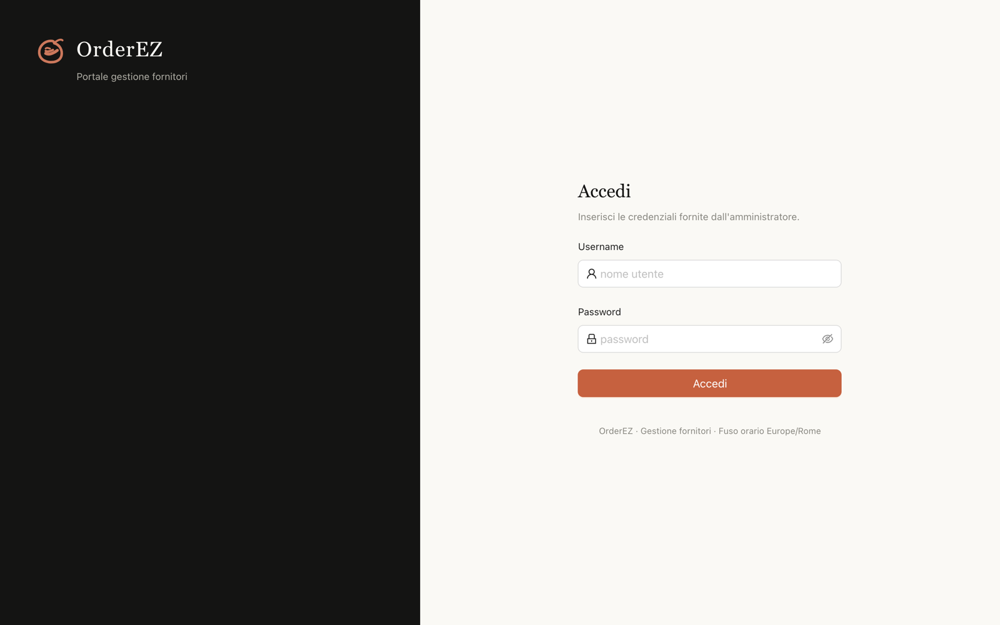
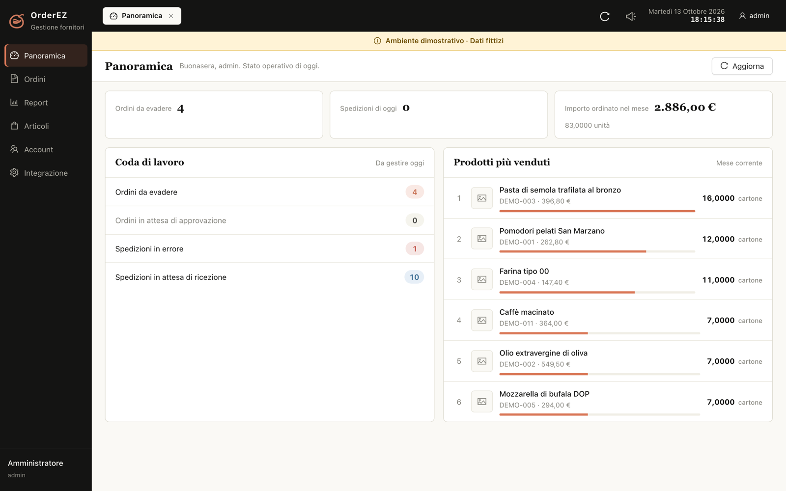
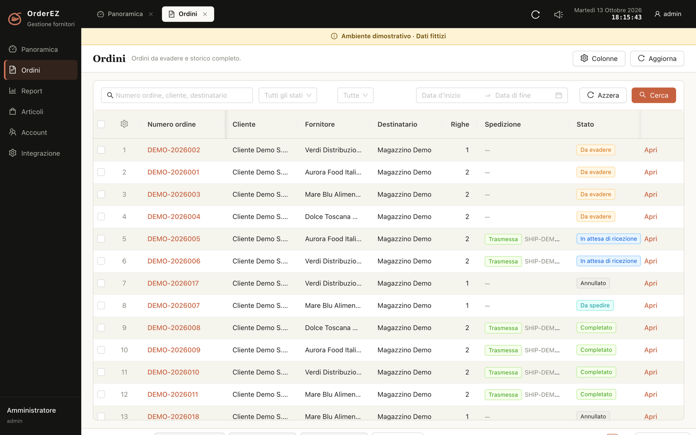
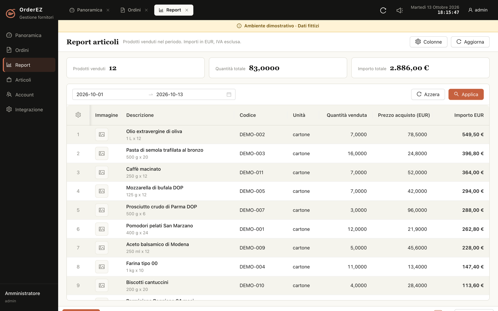

# OrderEZ Supplier Portal（意大利语供应商管理端）

给「国内订货 ERP + 海外供应商」这种组合用的一套 Web 系统：**管理端**给平台方看全局，
**供应商端**给不会中文、只看得懂意大利语的人用来查单、发货、看报表。

界面**全意大利语**（`it-IT`）、金额**只算 EUR**、时区按 `Europe/Rome` 走。

> 本项目以 **PolyForm Shield 1.0.0** 发布：**源代码可见，但不是 OSI 开源**。
> 可自建自用、可在自己公司内部为客户部署；不得用于提供与本项目构成竞争的产品或服务。
> 详见 [LICENSE](./LICENSE)。

---

## 界面

| 登录 | 首页 |
| --- | --- |
|  |  |

| 订单 | 报表 |
| --- | --- |
|  |  |

（以上是内置演示数据 `pnpm seed:demo` 的效果，供应商与商品均为虚构。
图片源文件：`docs/assets/screenshots/login.png`、`dashboard.png`、`orders.png`、`reports.png`。）

## 它解决什么

国内订货 ERP 的供应商门户基本都是中文界面、按国内习惯设计的。当供应商在国外、
只懂当地语言时，直接给它们开 ERP 账号是行不通的：语言不通、字段看不懂、
金额币种和时区对不上、也分不清哪些单是自己的。

这套系统做的是中间层：

- **只读 + 只写必要动作** — 从 ERP 拉订单/商品/供应商档案，供应商在门户上做的唯一写操作是「登记发货」
- **语言与单位本地化** — 意大利语界面、EUR 金额、`Europe/Rome` 时间、意式数字格式
- **数据隔离** — 供应商登录后只看得到自己的订单、发货和报表
- **同步是拉模式** — 定时按水位增量拉单，ERP 不需要做任何对接改造

## 功能

**管理端**

- 首页 KPI：待发货、今日已发、本月金额与数量、异常队列
- 订单：列表筛选、详情、上下单切换、打印、导出 Excel
- 报表：按商品聚合的销量与金额（EUR，IVA 除外），支持区间筛选与导出
- 商品与供应商档案、供应关系映射（订单归属供应商）
- 账号管理：建账号、绑供应商、改密、停用
- 集成设置：ERP 凭证唯一入口 + 连接自检
- 同步：定时拉单、手动触发、同步日志

**供应商端**

- 只看到自己的订单，登记发货（回写到 ERP）
- 商品与自己的报表
- 修改自己的密码

## 技术栈

| 层 | 选型 |
| --- | --- |
| 后端 | NestJS 10 · Prisma 5 · PostgreSQL 16 · BullMQ（可选 Redis） |
| 前端 | Vue 3 · TypeScript · Vite 6 · Ant Design Vue 4 · Pinia |
| 部署 | Docker Compose（Nginx + 后端 + Postgres + Redis） |

## 快速开始

### Docker（推荐）

```bash
cd deploy
cp .env.example .env     # 填 POSTGRES_PASSWORD / JWT_SECRET / CREDENTIALS_KEY
docker compose up -d --build

# 首次启动会自动创建管理员账号，密码只打印这一次
docker compose logs backend | grep -A6 "Nessun account"
```

访问 `http://localhost:8080`，用日志里的 `username` / `password` 登录 —— **进去第一件事是改密码**。

不想翻日志，就在 `.env` 里把 `SEED_ADMIN_PASSWORD` 填上，启动后直接用那组账号登录。
后端只在**库里一个用户都没有**时才自动建账号，之后重启不会覆盖任何人的密码。

### 先看看界面（可选，不需要 ERP 凭证）

```bash
docker compose exec backend node_modules/.bin/ts-node prisma/demo-seed.ts
```

写入一套**虚构**的意大利食品供应商 / 商品 / 订单数据（会先清空业务表），
界面顶部会常驻一条 `Ambiente dimostrativo` 提示条。演示环境的账号：

| 角色 | 账号 | 密码 |
| --- | --- | --- |
| 管理员 | `admin` | `OrderEZ@2026` |
| 供应商 | `fornitore1` ~ `fornitore4` | `Fornitore@2026` |

真实使用前用 `prisma/seed.ts` 重建管理员，或在「Integrazione」页里重置数据。
完整部署说明（域名、HTTPS、备份、升级、排障）见 [docs/DEPLOY.md](./docs/DEPLOY.md)。

### 本地开发

前置：Node.js 20+、PostgreSQL 16。

```bash
# 后端（用 pnpm）
cd backend
cp .env.example .env        # 填 DATABASE_URL / JWT_SECRET / CREDENTIALS_KEY
pnpm install
pnpm prisma migrate deploy
pnpm start:dev              # http://127.0.0.1:3100/api
                            # 首次启动自动建管理员：admin / OrderEZ@2026
                            # （取 backend/.env 的 SEED_ADMIN_PASSWORD，留空则随机并打印在日志里）

# 前端（用 npm，另开一个终端）
cd frontend
npm install
npm run dev                 # http://127.0.0.1:5273，已代理 /api 到 :3100
```

只跑前端界面、不连后端时，`npm run preview` 也可以：打包产物 + 同一套 `/api` 代理。

## 角色与权限

| | 管理员 | 供应商 |
| --- | --- | --- |
| 订单 / 发货 / 报表 | 全部 | 仅自己那份 |
| 商品 / 供应商档案 | 读写 | 只读自己相关 |
| 账号管理 `/accounts` | ✅ | 403 |
| 集成设置 `/settings` | ✅ | 403 |
| 同步 `/sync` | ✅ | 403 |
| 修改密码 | 任何人 | 任何人 |

## 目录结构

```
.
├─ backend/          NestJS + Prisma + PostgreSQL（中间服务）
│  ├─ prisma/        数据模型、迁移、种子与演示数据
│  └─ src/           按模块划分，见 docs/ARCHITECTURE.md
├─ frontend/         Vue 3 + Vite + Ant Design Vue
├─ deploy/           Docker Compose、Dockerfile、Nginx 配置、环境变量模板
└─ docs/             架构说明、部署说明、图片
```

## 文档

- [docs/ARCHITECTURE.md](./docs/ARCHITECTURE.md) — 模块划分、数据模型、同步机制、业务口径
- [docs/DEPLOY.md](./docs/DEPLOY.md) — Docker / 手工部署、域名与 HTTPS、备份、升级、排障

## 许可

本项目以 **PolyForm Shield License 1.0.0** 发布，完整条款见 [LICENSE](./LICENSE)。

这不是 OSI 认可的开源许可证，而是「源代码可见」许可。简单说：

- ✅ 阅读、修改、自己部署使用，在自己公司内部或为客户部署
- ✅ 基于它做二次开发（需保留许可与版权声明）
- ❌ 用它提供与本项目构成竞争的产品或服务，包括转售、付费托管、去品牌分发

> Required Notice: Copyright 2026 广州阿德利网络科技有限公司 (Guangzhou Adelie Network Technology Co., Ltd.) — OrderEZ — https://www.adelieyun.com

## 联系我们

| | |
| --- | --- |
| 电话 | 18927528608 |
| 邮箱 | vip@adelieyun.com |
| 官网 | [www.adelieyun.com](https://www.adelieyun.com) |

---

## English

**OrderEZ Supplier Portal** — an Italian-language supplier portal that sits in front of a
domestic ordering ERP. Platform staff get an admin console; overseas suppliers get a
portal in Italian to review their own orders, register shipments and read reports.

- UI in Italian only (`it-IT`), amounts in EUR, times in `Europe/Rome`
- Pull-based sync from the ERP, with watermarks and scheduled reconciliation
- Strict per-supplier data isolation
- NestJS + Prisma + PostgreSQL backend, Vue 3 + Vite frontend, Docker Compose deployment

```bash
cd deploy && cp .env.example .env   # set POSTGRES_PASSWORD / JWT_SECRET / CREDENTIALS_KEY
docker compose up -d --build        # http://localhost:8080
docker compose exec backend node_modules/.bin/ts-node prisma/demo-seed.ts   # fictional demo data
```

Licensed under the **PolyForm Shield License 1.0.0** — source-available, **not** OSI open
source. Self-hosting and internal or client deployments are permitted; competing products
and services are not. See [LICENSE](./LICENSE).
